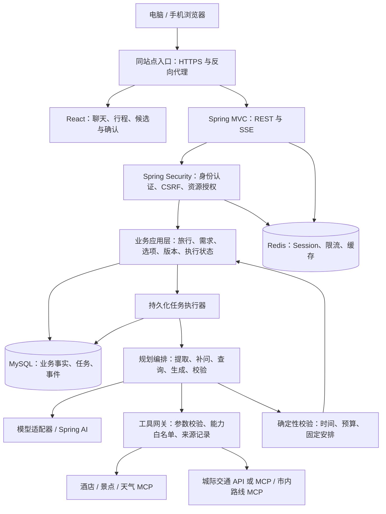
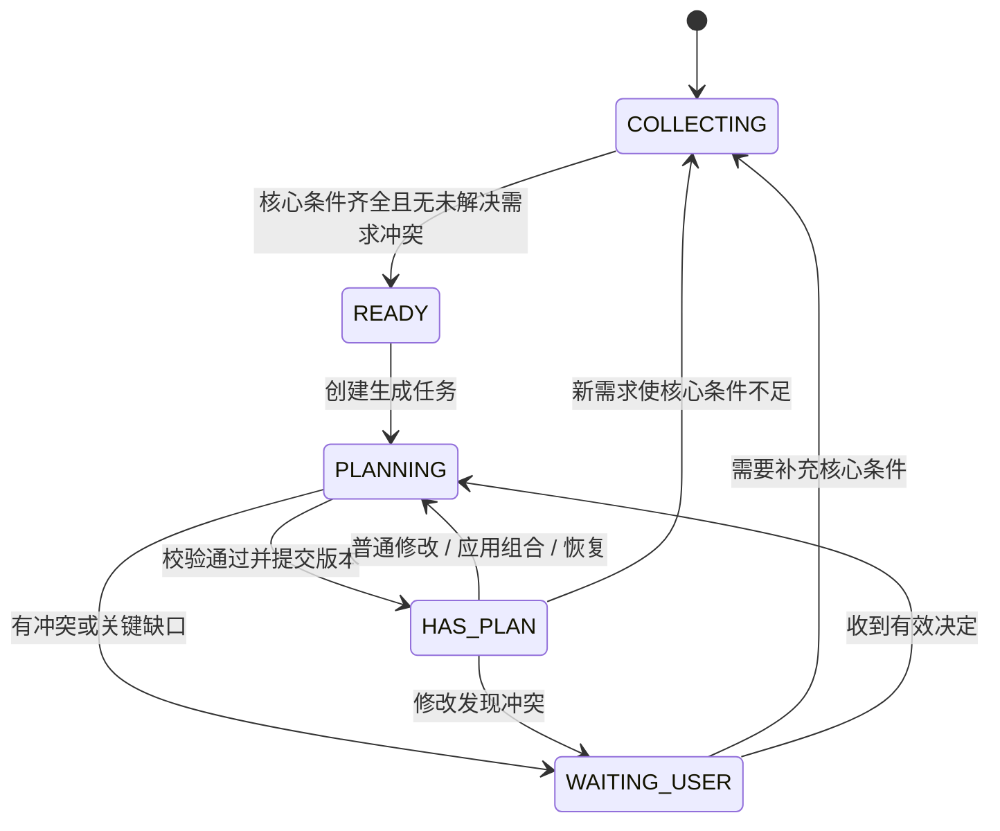
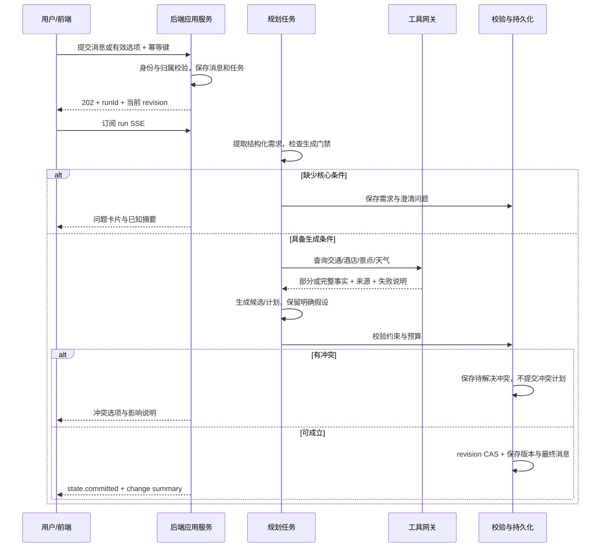

# 旅游规划智能体技术方案

版本：v0.1（架构设计稿）  
日期：2026-09-30  
产品依据：[产品规格 v0.5](./product-spec.md)

本文将当前产品行为转换为可实施的前端、后端、数据与接口设计。登录与用户隔离是本次补充的技术范围；首版采用一位用户独占自己的旅行，不引入多人协作或公开分享。文中的性能数值、登录方式和新增依赖属于建议，尚未经过实现与压测。

## 1. 总体方案与现有工程

采用 **React 单页应用 + Spring Boot 模块化单体 + MySQL + Redis + 后台任务执行器**。前后端独立开发、构建和部署，通过 REST 与 SSE 通信。生产环境由同一站点反向代理前端静态文件和 `/api`，减少浏览器跨域及会话配置复杂度。

“按照用户级别隔离”在本文中解释为按用户身份隔离旅行数据。不同账号拥有各自的会话、需求、行程、执行状态和查询记录；会员等级、套餐和配额不作为首版产品功能。

### 1.1 当前工程与技术选择

| 层次 | 当前仓库 | 技术方案 |
| --- | --- | --- |
| 前端 | React 19、TypeScript 6、Vite 8，仍是初始化页面 | 保留；增加 React Router、TanStack Query、Zustand；业务卡片使用自定义组件和可访问的交互基础组件 |
| 后端 | Java 21、Spring Boot 4.1.1、Spring MVC、Validation | 保留；增加 Spring Security、Spring Session、MyBatis-Plus（Mapper + XML）、数据库驱动；建表 SQL 手工执行 |
| AI 接入 | 尚未实现 | Spring AI 2.0.x，封装模型接口与 MCP 客户端；具体版本通过 BOM 锁定 |
| 数据库 | Compose 中的 MySQL 8.4 | 保存账号、业务状态、历史版本、任务和可恢复事件 |
| Redis | Compose 中的 Redis 8 | 保存登录会话、限流计数、短期查询缓存；不作为行程唯一存储 |
| 实时通信 | 尚未实现 | POST 接收命令，GET SSE 展示流式文字和业务进度 |
| 部署 | 本地基础服务 Compose | 静态站点/反向代理 + 后端容器 + MySQL + Redis；首版不拆微服务 |

Spring AI 官方文档说明 2.0.x 支持 Spring Boot 4.0.x 和 4.1.x，因此与当前工程方向一致；实施时仍需完成依赖解析、应用启动和 MCP 最小调用验证。[Spring AI 兼容性说明](https://docs.spring.io/spring-ai/reference/getting-started.html)

前端新增库不在现有依赖中，本方案不修改依赖文件。账号、数据访问、AI 适配等 Spring 依赖由 Boot 和 AI BOM 管理，避免自行拼接不同代际版本。

### 1.2 架构图



模型负责理解和生成建议，业务服务负责授权、状态流转和最终提交，校验器负责可计算规则。模型没有直接写库权限，也不能决定跨用户数据访问。

## 2. 功能模块划分

| 产品能力 | 前端模块 | 后端模块 | 实现重点 |
| --- | --- | --- | --- |
| 注册、登录、退出 | 登录页、注册页、会话恢复、账号菜单 | `identity` | 密码哈希、Session、CSRF、登录限流 |
| 我的旅行、继续规划 | 旅行列表、会话入口 | `trip` | 所有查询限定当前用户，恢复最新快照 |
| 跨轮需求收集 | 聊天、需求摘要、快捷问题 | `conversation`、`requirement` | 区分未回答、不知道、无偏好；日期和预算门禁 |
| 初版生成 | 真实阶段进度、已有内容保持可读 | `planning`、`validation` | 硬约束、查询缺口、结构化计划 |
| 交通和酒店候选 | 候选卡片、已选组合、加入行程 | `selection`、`integration` | 候选、已选、已预订分开；显式应用组合 |
| 用户指定酒店 | 酒店确认卡片、费用口径选项 | `requirement`、`selection` | 保留用户陈述，核实酒店；不默认已预订 |
| 景点与路线 | 活动卡片、交通衔接、来源详情 | `integration`、`validation` | POI 身份、开放与预约、移动时长 |
| 天气与携带建议 | 天气独立状态区、影响提示 | `weather` | 用户打开触发、重复合并、覆盖范围、禁止自动改计划 |
| 行程修改与冲突 | 自然语言输入、冲突选项、变更摘要 | `planning`、`decision` | 普通修改直接提交，冲突等待决定 |
| 历史版本 | 版本列表、差异对比、恢复入口 | `versioning` | 不可变快照；恢复产生新版本 |
| 旅途中调整 | 今天剩余安排、带上下文的讨论入口 | `execution`、`planning` | 位置由用户报告，完成和跳过事实独立保存 |
| 可恢复任务 | 断线提示、继续查看进度、重试 | `run` | 幂等、持久化、SSE 补偿、失败可恢复 |

模块间通过应用服务与明确 DTO 协作，不直接访问其他业务的 Mapper。首版采用 Java 包边界，避免在业务尚小的时候增加独立服务运维成本。

## 3. 登录、认证与用户数据隔离

### 3.1 首版账号流程

建议首版采用用户名与密码注册/登录，昵称单独保存。手机号、微信和短信登录作为后续接入选项，不作为目前未验证的外部依赖。

1. 未登录用户进入登录页，可切换注册。深链接只保存站内目标路径，登录后经资源授权恢复。
2. 注册时校验规范化用户名、唯一性和密码规则；唯一约束处理并发注册。密码采用 Spring Security `PasswordEncoder` 的自适应哈希，首版可用 BCrypt，成本参数在目标机器基准测试后确定。
3. 登录成功轮换 Session ID，Redis 保存用户身份，响应设置会话 Cookie。
4. 页面初始化通过 `/auth/me` 恢复身份，再加载该账号的旅行列表。
5. 退出销毁当前 Session 并关闭事件订阅，前端清除该账号的数据缓存和视图草稿。
6. 修改密码需要当前密码验证，并撤销该用户已有 Session，要求重新登录。

首次建议空闲过期 24 小时、绝对有效期 7 天；登录时间与绝对截止时间存入服务端 Session，并在普通请求与 SSE 检查，不能只依赖 Redis 的滑动 TTL。后台流式心跳不能延长绝对有效期。正式数值按登录留存需求调整。首版不默认无限期保持登录。

账号恢复不能只靠用户名执行。内测采用邀请账号和受控身份核验流程；开放公众注册前，需要补充已验证邮箱或手机号及一次性恢复凭证。恢复凭证需有有效期、只存哈希、消费后失效，并撤销旧会话。该项作为公众上线门禁，不影响先实现基础登录闭环。

### 3.2 认证方式

使用 **服务端 Session + HttpOnly Cookie**。当前是浏览器应用，Session 便于主动撤销、密码变更失效和 SSE 鉴权；首版不需要前端自行持有长期访问令牌。

| 项目 | 设计 |
| --- | --- |
| 会话 Cookie | 生产环境 `Secure`、`HttpOnly`、`SameSite=Lax`、`Path=/`，不设置宽泛 Domain |
| Cookie 名称 | 生产建议 `__Host-travel-session`；本地 HTTP 使用专用开发配置 |
| Session 存储 | Spring Session Redis，使用具备用户索引的 Repository 支持全会话撤销 |
| CSRF | 保留保护；`GET /auth/csrf` 返回令牌及 header 名，前端仅在内存中保存，写请求附带该 header |
| 登录与注册 | 写请求同样校验 CSRF；身份成功变更、退出后重新取得令牌 |
| 跨域 | 生产同源代理；开发 Vite 代理 `/api`。若分域，显式配置允许的来源和 credentials，不使用通配来源 |
| 未认证 | API 返回 JSON `401`，SSE 断开后通过 `/auth/me` 判断身份，不把 HTML 登录页送入事件流 |
| 密码与凭证 | 不写日志、不放模型上下文、不存 localStorage；设置输入长度限制并遵循所选哈希算法限制 |

Spring Security 对 SPA 的 CSRF 令牌获取与登录/退出后的刷新有专门要求，实施须与所用版本的处理器配置一致。[Spring Security CSRF](https://docs.spring.io/spring-security/reference/servlet/exploits/csrf.html) Spring Session 的用户索引可用于查找与撤销该用户会话。[Spring Session API](https://docs.spring.io/spring-session/reference/api.html)

### 3.3 资源授权：服务端强制隔离

`user_id` 只来自认证 Principal，客户端和模型不能指定当前操作者。所有旅行私有资源均绑定 `owner_user_id`，包括消息、选项、版本、查询任务与 SSE 事件。

```sql
-- Mapper XML 必须使用带 owner 的查询，不使用裸 findById 后直接返回。
SELECT * FROM trip
WHERE id = :tripId AND owner_user_id = :currentUserId AND deleted_at IS NULL;

-- 子资源必须同时检查所属旅行和操作者，不凭 versionId 单独查询。
SELECT v.* FROM plan_version v
JOIN trip t ON t.id = v.trip_id AND t.owner_user_id = v.owner_user_id
WHERE v.id = :versionId AND t.id = :tripId
  AND t.owner_user_id = :currentUserId AND t.deleted_at IS NULL;
```

具体要求：

- 所有读取、写入、分页、恢复、任务状态、事件重放和天气接口都执行资源归属检查；非本人资源统一返回 `404`。
- UUID/ULID 只是资源标识，不能代替授权。首版普通用户无查看他人攻略的权限。
- 业务表采用 `(owner_user_id, trip_id, …)` 查询索引；子表通过复合外键关联同一 owner 的旅行，阻止插入跨用户引用。
- Worker 接收从已认证请求持久化的 owner，重新验证旅行状态；不依赖异步线程里隐式传递的请求安全上下文。
- 私有 Redis key 和幂等记录包含 owner；前端 Query key 同样包含当前账号 ID。公共 POI/天气缓存只存无用户信息的事实，不缓存个性化推荐或聊天。
- 登录切换时关闭旧 EventSource、取消旧请求并清空 Query/Zustand 数据；迟到的响应以账号与订阅标识核对后丢弃。
- 登录、退出和会话失效通过 `BroadcastChannel` 通知同浏览器其他标签页清除旧身份数据；重新请求 `/auth/me` 后再恢复内容。
- 私有响应使用 `Cache-Control: no-store`，前端首版不让 Service Worker 离线缓存私人攻略。
- 工具调用只携带查询所需城市、日期、人数等数据；不发送密码、Session 或内部 user ID。模型上下文只取当前用户当前旅行。

## 4. 前端架构与交互体验

### 4.1 页面与路由

| 路由 | 页面 | 主要行为 |
| --- | --- | --- |
| `/login`、`/register` | 登录与注册 | 字段级反馈、密码管理器支持、登录后恢复站内入口 |
| `/trips` | 我的旅行 | 最近更新、日期、规划状态；新建旅行入口 |
| `/trips/:tripId` | 旅行工作台 | 电脑聊天与行程并列；手机默认聊天 |
| `/trips/:tripId?view=itinerary&day=…` | 行程视图定位 | 记录当前视图与日期，支持从变更摘要进入对应一天 |
| 版本抽屉/弹层 | 历史版本 | 展示时间、变更理由与差异；恢复走后端校验 |
| 账号菜单/弹层 | 账号管理 | 昵称、修改密码、退出 |

路由鉴权在获取 `/auth/me` 后完成。身份加载期间展示骨架，避免先闪现他人的缓存或错误地把有效 Session 当成未登录。

### 4.2 电脑端布局

```text
┌────────────────────────────────────────────────────────────────┐
│ 我的旅行入口    武汉 · 10/16—10/18    已保存 v3       账号菜单  │
├──────────────────────────┬─────────────────────────────────────┤
│ 对话区                   │ 行程面板                            │
│ 已知需求摘要，可折叠     │ 日期与每日概览                       │
│                          │ [第1天] [第2天] [第3天]              │
│ 智能体追问与解释         │                                     │
│ 候选/确认/冲突卡片       │ 活动、移动、休息时间线               │
│ 真实查询/规划阶段         │ 交通与酒店 · 已选组合                │
│                          │ 预算 · 天气 · 预约与准备              │
│ [描述需求或修改…] [发送] │ 变化摘要与待核实信息                  │
└──────────────────────────┴─────────────────────────────────────┘
```

初始比例建议聊天 40%、行程 60%，允许拖动分隔线，在较窄窗口切换为单列。两侧读取同一旅行快照，避免聊天显示 v4 而行程仍显示 v3。

### 4.3 手机端布局

使用固定的“聊天 / 行程”切换条，一次展示一个全屏视图。首次默认聊天；初版提交成功后显示“查看行程”，不突然切走用户正在输入的内容。

- 顶部展示旅行标题、当前状态和切换条，底部输入框考虑安全区域和软键盘。
- 行程按日期和时间线组织，交通、酒店、预算、天气可折叠；行程期内优先今天，否则进入上次查看日期或第一天。
- “讨论这一天”“讨论此活动”将 `dayId/activityId` 加入输入上下文，回到聊天并聚焦输入框；用户自行描述修改。
- 上下文以可移除标签展示，避免用户不知道“这里”指向什么。
- 切换时保留聊天输入、所看日期、展开卡片和两侧滚动位置；URL 只保存非敏感定位信息。
- 设备时间仅用于突出今天，不能据此推断当前位置或用户已到酒店。

首版不提供活动拖拽、直接删除或内联改时间。完成、跳过和临时变化也通过聊天表达，防止绕过智能体的约束检查。

### 4.4 按用户阶段设计反馈

| 阶段 | 用户看到什么 | 交互原则 |
| --- | --- | --- |
| 需求不足 | 已知摘要 + 本轮 2～3 个关键问题 | 已明确不重复问；未知、无偏好和未回答区分 |
| 日期/预算待确认 | 日期选择器、金额/覆盖范围确认卡片 | 不预填为已确认；可给“暂不确定”，仍不解锁生成 |
| 外部查询 | “查询交通”“核实酒店”“查询天气”等真实阶段 | 只依据后端事件，不能展示虚假的百分比 |
| 初版生成 | 流式解释 + 已提交前的生成状态 | 不把未校验的 JSON 片段当作可执行活动 |
| 普通修改 | 保留当前行程，展示修改范围；提交后突出变化 | 不加一轮全局“是否应用”确认 |
| 发生冲突 | 具体冲突、受影响安排、解决方案按钮 | 等待用户决定；自由输入始终可用 |
| 查询失败 | 哪项失败、影响是什么、哪些仍可查看 | 局部错误不覆盖整页；支持对应查询重试 |
| 已保存 | 版本号、保存时间、变更摘要 | 新版本提交后才显示“已保存” |
| 断线/超时 | 保留当前内容，显示重连或任务状态 | 不因网络断开自动重复发送用户指令 |
| Session 失效 | 登录提示与恢复入口 | 清除私人显示；未发送草稿仅在当前内存保留，校验回到同账号才恢复 |

登录表单支持键盘提交、字段标签、密码显隐、密码管理器自动填充。旅行卡片和选项支持键盘操作及可见焦点；状态不能只靠颜色。流式文字批量更新，不把每个 token 都交给屏幕阅读器播报；重要阶段使用克制的 `aria-live` 提示。

### 4.5 候选、确认与差异组件

**交通卡片**：班次、日期、抵离站点和时间、席别、返回的价格/余票、查询时间、与首末日的关系；缺失字段显示“未提供”，不能补成已查询结果。

**酒店卡片**：名称、位置、房型、房间数、入住人数、入住/退房日期、晚数、价格口径、推荐原因、路线关系和来源。已选与已预订分别标记。

**组合栏**：清楚展示已选交通与酒店，提供“将已选交通和酒店加入行程”。只选一项先保存选择，另一项保持待选；需要另一项才能完成的规划不伪装为就绪。用户指定酒店可作为组合中的住宿安排。

**确认/冲突卡片**：每个按钮带后端 `optionId`，显示选择的具体影响；点击中禁用重复操作，成功后保留选中记录。过期时显示原因及最新问题，不把旧按钮替换文字后继续执行。

**变更组件**：新增、移除、移动、时长变化和预算变化按日期归组。动画短暂突出变化，保留查看前后对比入口；预约/订单仍需用户处理的事项单独展示。

### 4.6 前端状态边界

| 状态 | 存放位置 | 约束 |
| --- | --- | --- |
| 用户、旅行快照、消息、版本、选项、任务 | TanStack Query | key 包含账号；后端是事实来源 |
| 手机视图、当前日期、滚动位置、输入上下文 | Zustand/局部状态 | 不复制完整行程到另一份 store |
| 流式文本和进行中阶段 | 当前 run 事件缓冲 | 按 eventId 去重，结束后与最终消息对账 |
| 未发送输入 | 当前内存 | 不默认持久化私人聊天到 localStorage |
| 天气更新动作 | 专用 mutation / 状态模块 | 仅由定义好的用户打开事件发起 |

SSE 收到 `state.committed` 后按 `stateRevision` 更新或重新读取快照；比当前 revision 更旧的事件不覆盖数据。移动端两个视图同时订阅同一个缓存实体。

天气读取可以通过 GET 获取已保存结果，但外部查询必须走显式 POST。天气相关 Query 禁止焦点、重连、组件重新挂载引发工具调用；TanStack Query 默认会在窗口重新获得焦点时刷新陈旧查询，因此需要专门配置。[TanStack Query 焦点刷新说明](https://tanstack.com/query/latest/docs/framework/react/guides/window-focus-refetching)

## 5. 后端架构与领域状态

### 5.1 分层与目录建议

```text
com.niewen.travelagent
├── controller/         HTTP 接口与输入转换
├── dto/                请求参数与格式校验
├── vo/                 API 响应，和数据库实体分离
├── entity/             MyBatis-Plus 表实体
├── mapper/             BaseMapper 接口；SQL 位于 resources/mapper/*.xml
├── service/            账号、审计、管理及未来旅行业务的接口
│   └── impl/           业务规则、授权、事务与编排
├── config/             Security、MyBatis 与配置属性注册
│   └── properties/     类型化配置与默认值校验
├── filter/             请求追踪、会话守卫、认证限流
├── handler/            安全回调与协议响应
├── security/           登录主体与 UserDetailsService
├── runner/             一次性初始化入口
├── utils/              账号规则、转换和通用工具
├── constant/           常量
└── exception/          业务异常与统一映射
```

采用 `Controller → Service → ServiceImpl → Mapper → XML` 的标准分层。Controller 校验请求格式并取得认证主体，服务落实授权、业务规则和事务，Mapper XML 使用参数绑定执行 SQL。DTO/VO 不暴露实体中的密码哈希等内部字段；Redis、模型与工具协议通过各自服务/适配器处理。后续旅行、对话、规划等业务在相应层内按业务建立子包，保持服务边界，不把所有业务集中到一个类。

### 5.2 三类状态独立保存

1. **旅行需求**：用户期望什么。包括目的地、确认日期、人数、预算、偏好、固定安排、已选内容与来源。
2. **行程计划**：打算怎么安排。每次变更生成不可变版本；当前版本由旅行聚合指向。
3. **执行事实**：实际发生了什么。完成、跳过、进行中、报告位置和时间独立于计划版本。

外部查询是第四类辅助事实，不能混入用户已经确认的需求。天气有独立有效性与刷新状态，不通过生成计划版本来保存每次预报。

### 5.3 业务状态机



该状态表示当前规划流程，不表示行程是否已经出发；出行中/已结束由旅行日期和用户报告辅助展示。任务失败保存独立 run 状态，已有行程仍可阅读。需求变化导致旧版本不适用时，快照显示 `needsReplan` 和影响说明，不能继续称为最新已验证方案。

### 5.4 信息项状态与生成门禁

需求字段采用统一结构：`value + answerState + source + confirmedAt + evidenceId`。

- `UNANSWERED`：尚未回答。
- `UNKNOWN`：用户明确不知道。
- `NO_PREFERENCE`：用户明确无偏好，仅用于适合该含义的字段。
- `PROPOSED`：模型理解或提供的值，需确认后才能用作核心条件。
- `CONFIRMED`：用户直接明确表达或点击有效选项确认。

另设 `assumptions[]`，仅容纳允许采用的非核心假设，不能把默认日期或预算塞入确认字段。用户明确给出的具体日期可视为确认，不再重复追问；“下周末”等歧义表达需展示绝对日期让用户确认。

`GenerationGate` 用代码检查：单城市目的地、已确认且有效的日期区间、可计算天数、正整数人数、预算金额与覆盖范围、无未解决需求冲突。未指定预算单位时按产品规则记录人均默认，并显示来源为 `PRODUCT_DEFAULT`；金额和覆盖范围不得默认。

城际交通查询另检查出发地与日期；酒店查询另检查入住/退房、人数、房间数和必要房型条件。未定首末日抵离时间可明确假设用于草案，不能标为已订交通。

### 5.5 预算与时间计算

金额使用十进制精确类型（Java `BigDecimal` / 数据库 `DECIMAL`），协议传十进制字符串，币种首版 CNY。各费用同时记录范围、计价单位、人数/房间数/晚数、核实状态和适用日期。

```text
全体预算上限 = 人均预算 × 人数，或用户明确的全体预算
住宿总额 = 每房每晚价格 × 房间数 × 入住晚数
计入预算的总额 = 仅累加用户确认覆盖的费用项目
人均展示 = 全体共享费用 / 人数 + 每人单独费用
```

供应商返回住宿总价时直接采用其明确覆盖范围，不能再次乘晚数。价格区间合并为区间；未知值为 null，不能当作零元。住宿单独计算时从预算占用排除，但仍单列金额与核实状态。

预算上限校验采用保守的区间上界；估算可能超出上限或关键费用未知时展示风险/冲突，不宣称已严格满足预算。例如两人共享一间房、每晚 400 元、两晚，住宿总额 800 元、人均 400 元，不能给每人重复计入 800 元。

旅行日期使用 `LocalDate`，目的地时区首版 `Asia/Shanghai`；活动时间绑定日期和目的地时区，查询/审计时间保存 UTC Instant。跨午夜交通使用完整日期时间，不只保存“23:00/01:00”。晚到调整先确认用户指的是哪一天和位置，不能单纯按服务器当前日期重排。

## 6. 数据模型与持久化

### 6.1 核心表

下表中除 `app_user` 外，所有私有业务表都包含 `owner_user_id`。`trip` 是授权根；子表使用 owner 与 trip 的复合关联。DDL 在实现阶段放入 docs/sql，由 MySQL 客户端手工执行，不启用自动迁移。

| 表 | 主要字段 | 作用与约束 |
| --- | --- | --- |
| `app_user` | id、normalized_username、nickname、password_hash、status、created_at | 用户名唯一；密码仅哈希 |
| `trip` | id、owner、title、current_plan_version_id、state_revision、weather_revision、active_mutation_run_id、active_weather_run_id、active_weather_signature、planning_status、needs_replan、deleted_at | 当前旅行聚合；revision 控制业务状态并发；短事务设置活动任务关联 |
| `trip_requirement` | trip_id、schema_version、content_json、updated_at | 当前结构化需求、偏好、硬约束与来源 |
| `conversation` | id、trip_id、created_at | 首版每个旅行一个主要会话；未来可扩展多会话 |
| `chat_message` | id、conversation_id、sequence、role、content_json、client_message_id、run_id、status | 分页历史；client ID 唯一，禁止重复发送 |
| `plan_version` | id、trip_id、version_no、parent_id、restored_from_id、snapshot_json、change_json、reason、base_revision、created_at | 快照不可变；旅行内版本号唯一 |
| `activity` | id、trip_id、origin_activity_id、created_at | 跨版本稳定身份；版本引用该 ID |
| `execution_event` | id、trip_id、activity_id、type、occurred_at、reported_location、source_message_id | 完成/跳过等事实流水，保留修正记录 |
| `execution_state` | trip_id、activity_id、status、last_event_id | 最新执行投影，便于读取与规划 |
| `query_snapshot` | id、trip_id、tool、provider、request_hash、status、source_json、result_json、queried_at、validity_json | 外部事实与适用条件，结果可部分成功 |
| `candidate` | id、trip_id、kind、query_snapshot_id、payload_json、availability_status、expires_at | 交通/酒店可追溯候选 |
| `selection` | trip_id、kind、candidate_id/statement_id、selection_revision、applied_revision、booking_status | 已选与已应用组合分开，booking 只由用户报告确认 |
| `decision` | id、trip_id、kind、base_revision、weather_revision（可选）、query_snapshot_id（可选）、options_json、status、selected_option_id、resolution_json | 补问、费用口径、冲突；保存用户决定与建议所依赖的事实 |
| `agent_run` | id、trip_id、type、command_json、base_revision、state、lease_owner、lease_until、attempt、deadline、cancel_requested | 可靠任务与恢复；不能仅靠内存线程 |
| `run_event` | run_id、sequence、type、payload_json、created_at | SSE 可重放业务事件，run 内 sequence 唯一 |
| `weather_view` | trip_id、date_signature、query_snapshot_id、status、suggestions_json、updated_at | 当前日期对应天气和携带建议 |
| `idempotency_record` | owner、scope、key、request_hash、response_json、expires_at | 重复请求返回原结果；相同 key 不同请求体拒绝 |
| `audit_event` | owner、trip_id、action、trace_id、metadata_json、created_at | 登录、关键提交与工具访问审计，敏感值脱敏 |

`state_revision` 随需求、选择、决定、执行状态和计划提交等影响规划的操作递增；天气更新仅递增 `weather_revision`。`version_no` 只随计划版本增长。三个计数不能混为一谈。

### 6.2 计划快照结构

```json
{
  "schemaVersion": 1,
  "requirementRevision": 12,
  "assumptions": [],
  "unverifiedItems": [],
  "days": [{
    "dayId": "day_1",
    "date": "2026-10-16",
    "theme": "抵达与周边活动",
    "activities": [{
      "activityId": "act_123",
      "placeRef": "poi_456",
      "timeWindow": { "start": "15:30", "end": "17:00" },
      "durationMinutesRange": [60, 90],
      "priority": "PREFERRED",
      "fixedConstraintRefs": [],
      "evidenceRefs": ["query_789"],
      "verificationStatus": "PARTIALLY_VERIFIED"
    }],
    "transfers": [],
    "mealsAndBreaks": [],
    "costs": []
  }],
  "appliedSelectionRefs": [],
  "budgetSummary": {},
  "todos": [],
  "alternatives": []
}
```

以上仅是结构示例，地点和时间不代表实际查询结果。费用、移动等对象使用明确 Schema，不存成难以检验的自然语言字符串。前端活动卡片读取结构化 DTO，解释文本单独保存。

活动身份在移动、改变时间和恢复时保持稳定；真正替换为新活动生成新 ID。访问同一地点两次不靠 POI ID 合并为一个活动。模型给出的活动引用必须属于当前旅行；只有领域服务可创建新身份。

### 6.3 索引与存储边界

- `trip(owner_user_id, updated_at, id)` 支持我的旅行游标分页。
- `chat_message(owner_user_id, conversation_id, sequence)` 支持历史分页和顺序恢复。
- `plan_version(owner_user_id, trip_id, version_no)` 唯一；执行状态 `(owner_user_id, trip_id, activity_id)` 唯一。
- `agent_run(state, lease_until)` 支持任务领取；`run_event(owner_user_id, run_id, sequence)` 支持授权重放。
- 业务常用过滤字段采用列存储；JSON 用于需求、快照和供应商结构，均包含 schemaVersion。
- 不长期保存全部 token 事件。关键业务事件和最终消息在 MySQL，文字片段可用短期缓冲；片段缺失时返回最终消息或状态快照，不能声称无限期逐 token 恢复。
- 用户删除旅行后立即撤销读取和任务提交权限，软删除内容按配置保留期清理；公开上线前明确备份和删除保留策略。后台任务不得复活已删除旅行。

## 7. 智能体编排与行程校验

### 7.1 初版生成流程



候选查询不等同于自动选定：未选交通/酒店时可以展示候选或在满足产品草案条件时输出标明假设的草案。用户明确选择并加入后，再用实际抵离时间和酒店位置共同规划。不能把模型排名第一的候选写成用户已选。

### 7.2 模型与代码的职责

| 环节 | 模型职责 | 代码职责 |
| --- | --- | --- |
| 需求提取 | 识别意图、补充、更正、上下文指代 | Schema 校验、来源归属、核心字段确认规则 |
| 追问 | 组织简短自然语言与选项文案 | 检查缺口、不重复问明确未知、保存 decision |
| 查询 | 提出当前必要查询意图 | 工具白名单、必需参数、日期/人数校验、限流 |
| 规划 | 区域组合、顺序、理由和替代方案 | ID 绑定、事实引用、时间/费用/硬约束检查 |
| 修改 | 推断局部范围、生成差异 | 保留执行事实，拒绝未授权删除硬约束 |
| 提交 | 提供可解释的变更摘要 | 用户决定匹配、事务、CAS、版本及事件保存 |

采用受控状态机编排而非无上限自由工具循环。模型输出匹配版本化 JSON Schema，拒绝未知字段与不合法引用；最多进行两次结构修复，仍失败就保留旧行程并说明任务失败。模型、提示词、工具 Schema 版本写入 run 元数据便于回放。

上下文由最新需求、当前计划、执行投影、未解决决定、相关事实和最近消息构成。历史压缩摘要只辅助表达，不能覆盖结构化硬约束或用户已确认的决定。首版不引入向量数据库，避免给私人行程增加不必要的数据复制链路。

### 7.3 确定性校验

- **时间**：活动、移动、用餐、休息与机动时间不重叠；首末日受抵离交通约束；开放时段与固定预约相容。
- **路线**：使用可追溯坐标和路线结果核对移动衔接；距离估算必须标明依据，不能将地图距离直接写成已查交通分钟数。
- **预算**：按人数、房间数、晚数、覆盖范围和费用口径计算；未知关键费用阻止“预算已验证”状态。
- **固定安排**：已订交通、预约、用户要求保留的项目不可静默删除；明确用户指令可以解除对应约束，并记录证据。
- **执行状态**：已完成活动不重复安排；已跳过活动未经用户要求不重新加入；正在进行活动按当前指令处理。
- **事实完整性**：已核实标签必须存在有效证据；查询到候选不等于已预订；营业/预约未知时列为待核实。
- **缺口分类**：普通信息缺口允许部分计划并展示影响；关键可行性未确认则阻止相关安排确定；已知硬约束违反必须等待决定。

计划级别展示 `DRAFT / PARTIALLY_VERIFIED / VERIFIED_WITHIN_KNOWN_SCOPE`，同时附核实范围与时间，避免一个“已验证”徽标掩盖余票和价格随时变化的事实。

### 7.4 局部修改、日期变更与恢复

普通无冲突编辑直接产生新版本；用户不需要再批准已明确表达的修改。编排器先锁定受影响活动/日期，只有交叉影响成立时扩展到其他天并解释原因。

日期修改先保存明确的新需求与 `needsReplan`，使旧日期查询和选项失效，重新查询受影响的交通、酒店、景点。旧版本保留作历史展示，但不能当作适用于新日期的当前方案；必要时等待新冲突决定。

已有行程日期改变时仅使天气失效，不由修改任务主动查询新日期天气。用户下次点击打开当前行程再查询；修改任务不能绕过天气触发规则。

恢复旧版本是创建一份新版本：读取旧计划 → 合并最新执行事实 → 检查当前需求、已订项目、硬约束与事实有效性 → 无冲突提交，或输出冲突等待决定。旧版日期、房态、价格和用户曾经的候选状态不能悄悄覆盖当前需求与真实预订状态。

## 8. 外部 API / MCP 接入方案

### 8.1 接入边界与供应商选择

交通使用 API 或 MCP；酒店、景点、天气使用 MCP。后端统一提供领域接口，隐藏不同供应商返回格式。生产优先采用远程 MCP 连接；只有经过审核和固定版本的内部服务允许使用 stdio，不在请求期间下载执行未知服务。

Spring AI MCP Client 支持多客户端、传输方式与工具过滤，可承载接入层；实际允许调用的工具由本应用配置决定。[Spring AI MCP Client](https://docs.spring.io/spring-ai/reference/api/mcp/mcp-client-boot-starter-docs.html)

| 能力 | 首选接入方向 | 已知边界 / 实施门禁 |
| --- | --- | --- |
| POI、地理编码、市内路线 | 高德官方 MCP 作为首轮验证对象 | 官方列出地点检索、路线规划等能力；需核对具体线路、城市、返回字段和配额 |
| 天气 | 高德天气 MCP 作为首轮验证对象 | 需要实测预报覆盖日期、发布时间和查询参数；不承诺覆盖全部未来日期 |
| 景点开放、门票与预约 | POI MCP + 能返回权威字段的景点 MCP | 地点存在不等于开放/预约核实；不足时返回待核实，不能用模型记忆补齐 |
| 城际高铁班次、价格、余票 | 具备授权的铁路/旅行数据 API 或 MCP | 供应商尚未确定；售票窗口、出发站映射、席别、实际价与配额必须实测 |
| 酒店房型、价格、房态 | 具备授权的酒店 MCP；或内部 MCP 包装合法酒店数据服务 | 尚未确定供应商；地图酒店 POI 不足以证明房型/房态/报价能力 |

高德官方说明覆盖地点搜索、路径规划和天气查询，可用作首轮接入候选；不由此推断它具备酒店实时房态或铁路余票能力。[高德 MCP 概述](https://developer.amap.com/api/mcp-server/summary)

供应商的商用授权、费用、配额和凭证属于接入验证事项。铁路和酒店两类若缺少真实可用服务，开发可使用明确标注的测试 fixture，但上线不能以 mock 冒充实时查询；完整交通/酒店候选闭环需通过真实接口验收。

### 8.2 领域工具契约

| 领域接口 | 必需输入 | 标准化输出与缺口 |
| --- | --- | --- |
| `searchIntercityTransport` | 出发/目的城市或站点、出发日期、方向、人数、席别条件 | 班次、站点、完整抵离时间、席别、价格/余票（允许缺失）、售票状态、来源 |
| `planLocalRoute` | 起终点 POI/坐标、目的地城市、出发时间、交通偏好 | 路线分段、移动时间区间、换乘、步行、费用、适用时间 |
| `searchHotels` | 城市、入住/退房、人数、房间数、房型、价格条件 | 酒店与 POI、房型、容量、报价单位、税费/总额范围、房态和取消信息（如有） |
| `verifySpecifiedHotel` | 名称/地址/POI、日期、房型与人数 | 实体匹配候选、已核实字段、未返回字段；同名酒店歧义需用户选择 |
| `getAttractionFacts` | POI/名称、城市、访问日期 | 坐标、开放时间、预约、费用、日期例外、权威来源；字段级核实状态 |
| `getWeather` | 城市编码、确认日期区间 | 逐日覆盖、发布与查询时间、预报/实况类型、缺失日期、超范围状态 |

这些是应用内部契约，供应商真实 `toolName/inputSchema` 在 adapter 中映射，不能直接拿内部名称当作现成 MCP 工具。

统一响应包含 `status、data、missingFields、source、queriedAt、applicableDates、expiresAt、requestFingerprint、warnings`。状态至少区分 `SUCCESS / PARTIAL / EMPTY / UNSUPPORTED / OUT_OF_RANGE / TIMEOUT / ERROR`。有效期由字段时效与供应商能力确定，不能只用一个固定 TTL 表示所有事实。

来源保存供应商、工具名、数据 ID、可提供的来源 URL 和适用范围；供应商没有 URL 时不制造链接。公共数据缓存命中也显示事实原查询时间和 `fromCache`，不能用缓存读取时间伪装新查询。

### 8.3 查询可靠性与工具安全

查询只在输入满足条件时执行；相互独立的查询可在同一任务中并行，先获得酒店位置后再查询以酒店为起点的路线。建议单次工具超时 8～15 秒、只读瞬时故障最多重试一次，最终数值通过真实接口验证。

外部事实按查询参数缓存：必须包含日期、人数、房型、房间数、席别等影响结果的条件。余票与价格不能拿长期缓存作可用性保证；用户应用旧候选时重新核对必要字段，价格变化涉及预算则产生冲突。

工具网关仅允许已审核的查询工具和固定服务器；限制出站地址、调用次数、数据大小、运行时长和供应商费用。首版不注册购票、订房、支付、预约变更工具。

外部工具返回的文字和描述属于事实输入，不作为系统指令，不得改变权限、访问其他用户数据或要求执行任意 URL。不能仅依据工具声明的 `readOnlyHint` 判断安全性，MCP 官方规范将这类注解定义为不可信提示。[MCP 工具注解规范](https://github.com/modelcontextprotocol/modelcontextprotocol/blob/main/docs/specification/2025-06-18/schema.mdx)

## 9. 天气打开触发与独立更新

### 9.1 触发规则

| 动作 | 是否查询外部天气 |
| --- | --- |
| 初次生成行程，日期已确认 | 是，由初版规划任务调用 |
| 电脑端用户点击选择打开当前行程 | 是，发送显式打开命令 |
| 手机端用户切换进入当前行程视图 | 是，发送显式打开命令 |
| 同一个打开动作发生请求重试 | 复用幂等结果，不重复查询 |
| 正在查询时用户重复点击打开 | 合并正在进行的同日期查询 |
| 行程内切换日期、滚动、聊天更新、组件重挂载 | 否 |
| 浏览器返回前台、刷新普通快照 GET | 否 |
| 修改已有行程日期 | 只使原天气失效；下次显式打开时查询 |
| 用户点击天气失败重试 | 是，重新尝试该失败查询，仍合并进行中任务 |

打开命令由导航交互层发起，使用 `openActionId`。不要在 `useEffect` 或任何 GET 快照接口中自动调用天气工具。默认聊天、不展示行程内容的入口不发送天气打开命令；显式“查看行程”的深链接激活一次视图可视为一次打开动作。

### 9.2 后端流程

1. 校验用户和旅行归属，从服务端确认需求读取目的地与日期，不信任请求覆盖查询日期。
2. 条件不足时返回 `DATE_NOT_CONFIRMED` 等业务状态，不发工具查询。
3. 生成 `dateSignature = destination + confirmedDateRange + timezone`。
4. 通过旅行行锁及数据库活动任务关联，实现同 `(owner, trip, dateSignature)` 的查询 single-flight；多个点击获得同一 runId。Redis 可优化，但锁失效不应造成重复提交。
5. 返回当前可读行程和旧天气状态，异步调用 MCP；首版天气打开操作调用供应商而非只读取已完成缓存，进行中调用可以合并。
6. 保存结果前再检查当前签名。若期间日期改变，旧结果只存查询历史，不覆盖 `weather_view`。
7. 发布天气状态、查询时间、实际覆盖日期、携带建议与影响提示；不创建新的计划版本。

初版天气查询也登记到同一查询协调器，以免用户打开与生成任务同时重复调用。这里的后台执行器只处理已授权打开/生成动作，不定时主动查询天气。

### 9.3 失败、覆盖范围与天气影响

天气区状态为 `UNAVAILABLE / LOADING / READY / PARTIAL / STALE / ERROR`，附当前日期适用性。失败时，仅允许保留仍适用于当前日期的旧结果，并明确“上次查询时间，更新失败”；旧日期天气移到历史，不作为当前天气展示。

超出预报窗口的日期明确标注“暂无对应日期预报”。季节性建议单独标明依据，不能混入逐日预报。页面在查询过程中继续显示其他行程内容。

天气变化产生 `WEATHER_IMPACT` 类型的 `decision`，显示受影响的户外活动和调整选项。它绑定生成时的 stateRevision、weatherRevision 和查询快照；新预报或规划变化使旧建议失效。保存这类建议不递增 stateRevision，也不改变当前规划流程状态，避免天气提示干扰正在回答的住宿问题。用户选择后进入正常修改编排，重新检查路线、时间、预算和固定安排；天气更新本身不改变活动。

## 10. 前后端接口契约

### 10.1 通用约定

- API 前缀 `/api/v1`，JSON 使用 camelCase，ID 为不透明字符串。
- OpenAPI 作为接口契约，生成或校验前端类型；前端不依赖内部数据库实体。
- 业务写命令携带 `Idempotency-Key`；影响规划的写入携带 `expectedStateRevision`。幂等键限定当前账号和接口作用域，保留建议至少 24 小时。认证接口走独立安全流程，不缓存或重放登录成功、改密等敏感结果。
- `200/201` 用于同步完成，`202` 表示任务已持久化接收，附 runId；未持久化前不能返回已接受。
- 快照返回 `stateRevision、planVersion、weatherRevision、activeRuns、pendingDecisions` 和最近一页消息，允许一次恢复核心工作台；更早消息单独分页。
- 列表采用游标分页；查询缓存策略由具体接口定义，私人数据不经公共 CDN 缓存。

### 10.2 接口清单

| 方法与路径 | 用途 | 主要输入 / 输出 |
| --- | --- | --- |
| `GET /auth/csrf` | 获取/刷新 CSRF | token、headerName；匿名可用 |
| `POST /auth/register` | 注册 | username、password、nickname；注册成功后进入登录流程 |
| `POST /auth/login` | 登录 | username、password；会话 Cookie、用户摘要 |
| `GET /auth/me` | 当前身份 | 用户摘要，未登录 401 |
| `POST /auth/logout` | 退出 | 撤销 Session |
| `PATCH /auth/profile` | 修改昵称 | nickname |
| `POST /auth/password` | 修改密码 | currentPassword、newPassword；撤销全部 Session |
| `GET /trips` | 我的旅行列表 | cursor、limit |
| `POST /trips` | 新建旅行 | 可选 title；返回 tripId |
| `DELETE /trips/{tripId}` | 删除旅行 | expectedStateRevision；取消待提交任务 |
| `GET /trips/{tripId}/snapshot` | 工作台状态恢复 | 三类状态、天气、待答问题、当前任务；不调用天气工具 |
| `GET /trips/{tripId}/messages` | 历史消息 | beforeSequence、limit |
| `POST /trips/{tripId}/messages` | 自然语言命令 | clientMessageId、text、context、expectedStateRevision；runId |
| `POST /trips/{tripId}/decisions/{decisionId}/answer` | 选项/确认/冲突反馈 | optionId、expectedStateRevision；更新状态或新 runId |
| `POST /trips/{tripId}/selections` | 保存交通/酒店选择 | kind、candidateId、expectedStateRevision；不自动应用另一项 |
| `POST /trips/{tripId}/selections/apply` | 显式共同纳入规划 | selectedRefs、expectedStateRevision；核对后创建规划 run |
| `POST /trips/{tripId}/itinerary-open` | 用户打开行程并更新天气 | openActionId；weatherRunId / 条件不足状态 |
| `POST /trips/{tripId}/weather/retry` | 天气失败重试 | failedRunId；weatherRunId |
| `GET /trips/{tripId}/versions` | 历史版本摘要 | cursor、limit |
| `GET /trips/{tripId}/versions/{versionId}` | 单版本与差异 | version、changeSummary |
| `POST /trips/{tripId}/versions/{versionId}/restore` | 恢复为新版本 | expectedStateRevision；runId |
| `GET /runs/{runId}` | 任务状态 | 阶段、错误、最终消息、提交 revision |
| `GET /runs/{runId}/events` | SSE 订阅/重放 | Last-Event-ID 或 afterSequence |
| `POST /runs/{runId}/retry` | 重试可重试失败 | 原命令在最新 revision 上重新校验；不得重做已成功提交 |
| `POST /runs/{runId}/cancel` | 请求停止任务 | 标记取消；已提交任务不通过取消回滚 |

第一版不开放绕过聊天的 `PATCH /activities` 或“直接标记完成”接口；这些事实通过消息编排统一处理。账号恢复接口在开放注册前随恢复凭证方案补齐。

### 10.3 消息与选项示例

```json
{
  "clientMessageId": "client_msg_001",
  "text": "第二天少安排一点，晚上已订的餐厅保留",
  "context": { "dayId": "day_2" },
  "expectedStateRevision": 12
}
```

```json
{
  "decisionId": "decision_001",
  "kind": "HOTEL_BUDGET_SCOPE",
  "baseStateRevision": 12,
  "status": "PENDING",
  "question": "酒店费用是否在旅行预算之外单独计算？",
  "options": [
    { "optionId": "opt_1", "label": "单独计算", "effectSummary": "住宿费用另列，不占旅行预算" },
    { "optionId": "opt_2", "label": "计入预算", "effectSummary": "住宿费用纳入已确认的旅行预算" }
  ]
}
```

选项对应的实际动作保存在后端；客户端只传标识，不能提交可执行 action payload。自然语言答复也匹配同一个待答 decision；存在歧义时继续澄清，不强行选最近按钮。

### 10.4 错误协议

```json
{
  "code": "OPTION_EXPIRED",
  "message": "行程已更新，请使用当前选项。",
  "traceId": "trace_001",
  "retryable": false,
  "details": { "currentStateRevision": 14 }
}
```

| 状态码/业务码 | 前端行为 |
| --- | --- |
| `401 AUTH_REQUIRED` | 停止私有订阅，清理私人显示，进入登录恢复 |
| `403 CSRF_INVALID` | 刷新令牌；只对确认未执行的请求用相同幂等键重试一次 |
| `404 RESOURCE_NOT_FOUND` | 显示资源不可用，不透露是否属于他人 |
| `409 STATE_CHANGED / OPTION_EXPIRED / IDEMPOTENCY_MISMATCH` | 拉取新快照并提示，不能自动重放旧决定 |
| `409 RUN_IN_PROGRESS` | 显示当前任务，保留新输入草稿 |
| `422 CORE_INFO_MISSING / SELECTION_INCOMPLETE` | 展示必要问题，不采用默认核心信息 |
| `429 RATE_LIMITED` | 按 Retry-After 提示等待，保留输入 |
| `503 DEPENDENCY_UNAVAILABLE` | 当前行程可读，显示具体不可用能力 |

被模型识别的业务冲突一般以成功接收的 run 输出 decision，不伪装成系统异常。工具的部分失败是业务状态，不能都映射成整页 500。

## 11. 任务、流式反馈与一致性

### 11.1 SSE 设计

提交命令使用 POST，事件读取使用 GET EventSource，共用会话 Cookie。SSE 只承担输出，不使用 GET 创建规划或查询任务。

```text
id: 18
event: state.committed
data: {"runId":"run_001","stateRevision":13,"planVersion":4,"changedDays":["day_2"]}
```

事件类型至少包括 `run.started、stage.changed、text.delta、tool.started、tool.finished、tool.failed、decision.required、state.committed、weather.updated、run.completed、run.failed、run.cancelled`。事件 payload 不暴露供应商密钥或内部异常栈。

每个 run 顺序递增，客户端按 sequence 去重。断线通过 Last-Event-ID 重放；超出保留窗口时返回 `resync.required`，客户端读取 run 状态和旅行快照。重新连接不重新执行模型或工具。

建议 15 秒 SSE 心跳，代理关闭缓冲并设置合适的读取超时。SSE 初次与每次重连检查 owner；长连接发送事件/心跳时检查会话绝对有效期、撤销状态与旅行删除状态，失效立即关闭。退出和密码修改发出撤销信号，Redis Pub/Sub 仅用于即时通知，持久化状态仍是兜底。

只对确已完成的步骤发送“完成”；流式解释仅作阅读体验，权威行程以事务提交后的快照为准。断线不自动取消任务；用户显式停止才请求取消。

### 11.2 持久化任务

首版使用 MySQL `agent_run` 加租约的 Worker，避免新增消息队列运维。可以与后端同进程部署，但执行器使用有界并发和独立连接，不占用 HTTP 请求线程等待整次模型响应。

- 接收命令时，用旅行行的短事务锁检查并设置 activeMutationRunId，在同一事务保存用户消息、幂等结果与任务；天气协调器使用独立活动任务字段。终态/等待用户时释放对应活动关联，过期租约恢复期间仍保留关联，不能另建第二个同类任务。
- Worker 用短事务领取 QUEUED 任务并写 lease；调用外部服务时不持有数据库事务或行锁。
- 执行阶段续租并检查 cancel、deadline 与旅行状态；持久化关键阶段和必要结果。
- 进程退出或租约过期后可重新领取，读取已完成阶段；重跑只读工具允许有界重复，但版本提交必须幂等。
- 任务状态为 `QUEUED / RUNNING / WAITING_USER / SUCCEEDED / FAILED / CANCELLED`；`WAITING_USER` 停止占用 Worker，用户决定创建后续 run 并关联前序任务。
- 数据库事件日志作为可靠事件来源，事务提交后通知 SSE；通知丢失可由日志补读。部署多实例时，订阅节点也需从数据库补读，不能仅依赖本机内存 emitter。
- 建议每次 run 最多 12 次工具调用、模型/工具总运行截止 120 秒，均可配置；达到上限保留阶段结果并提示，不进入无限自动循环。

Worker 的内部领取/过期恢复周期是任务基础设施，不是产品天气的定时查询能力。

### 11.3 并发与旧选项

每个旅行同一时间只允许一个影响规划状态的活跃 run；多标签页第二次命令可返回 `RUN_IN_PROGRESS`，避免无解释地排队执行已过时输入。聊天草稿保留，任务结束后由用户重新发送。独立天气 run 可以并行。

任务启动记录 `baseStateRevision`。提交时通过短事务 compare-and-set 更新 trip；如果执行状态、需求或其他选择已经改变，拒绝旧结果提交，重新读取并有限重算或让用户看到版本变化提示。不能以“最后完成的任务获胜”覆盖较新的事实。

普通业务提交在同一事务写入需求/决定更新、计划版本、当前版本引用、最终消息与 `state.committed` 事件。天气独立事务核对 dateSignature 并更新 weatherRevision，不与计划版本 CAS 混用。

选项需检查 owner、trip、decision 状态、base revision、候选日期与有效期。保守策略是影响规划的 revision 改变即使旧选项失效，生成新选项；天气更新本身不让无关酒店选项过期。幂等检查在执行前完成：已成功消费的重复请求返回原结果，不误报为第二次修改。

取消在提交事务前检查；若提交先完成则返回已完成状态，前端如要撤回走新的自然语言修改或版本恢复。重新运行失败任务必须重检当前 revision；成功任务的重试只返回既有结果。

## 12. 部署、安全与运行维护

### 12.1 开发与生产

开发：Vite `/api` 代理到 Spring Boot；现有 Compose 启动 MySQL/Redis；MCP 和模型凭证通过本地环境变量注入，不进入 Git。

生产：HTTPS 入口服务前端静态资源并转发 `/api`；后端至少一个实例，Worker 初期同进程；MySQL/Redis 仅私网可达。现有 Compose 暴露 3306/6379 属于本地配置，生产部署改为内部网络。前后端分开产物、版本和部署，数据库变更向后兼容至少一个接口发布周期。

配置至少包含 `DB_*、REDIS_*、SESSION_*、MODEL_PROVIDER_*、MCP_SERVER_*、TOOL_TIMEOUT、RUN_DEADLINE、RUN_CONCURRENCY`。生产凭证由密钥管理注入，前端只得到公开站点配置。

MySQL 定期备份并演练恢复；Redis 会话丢失可导致重新登录，业务数据与任务不能因此丢失。SSE 降级时保留受限频率的 GET 任务状态查询，GET 轮询不得触发天气更新。

### 12.2 安全与隐私

- 注册/登录使用按 IP 与规范化账号组合限流，错误消息不泄露登录账号是否存在。
- 每用户限制活跃任务数量、请求频率与工具预算，阻止跨旅行无限发起昂贵查询。
- 生产 HTTP、数据库和外部工具连接使用适当加密；供应商凭证保留在后端。
- 对模型文本进行安全 Markdown 渲染，不允许任意 HTML；来源 URL 只允许安全协议，防止脚本链接。
- 防止未知 URL 工具请求与任意 MCP server 注册；校验重定向、目标地址及数据体积。
- 日志默认记录状态和标识，不记录完整密码、Cookie、位置报告、聊天或工具原始敏感数据。
- 对外模型只发送完成当前任务必要的信息；公众上线前明确模型/工具供应商的数据处理方式与用户知情说明。

### 12.3 可观测性与初始目标

使用统一 `traceId + runId + tripId` 串联请求、Worker、模型、工具和提交。记录工具成功率/部分成功率/延迟、模型结构输出失败、Token 与工具调用成本、revision 冲突、幂等命中和 SSE 重连。

以下是建议验收目标，不是现有能力承诺：

| 指标 | 初始目标 |
| --- | --- |
| 普通快照/列表 API | 内测约定负载下 P95 < 500ms，不含外部查询 |
| 命令接收与任务反馈 | P95 < 1 秒返回 runId，随后展示实际阶段 |
| 行程生成/复杂修改 | 目标 15～60 秒；到达配置 deadline 后明确结束或报告失败 |
| 登录恢复和手机切换 | 切换不重置输入与滚动；缓存命中时不等天气请求 |
| 用户隔离 | 跨账号读取、写入、事件重放成功数为 0 |
| 预算/固定安排 | 已知硬约束违规不能自动提交为正常计划 |

数值在 P0 外部工具验证后修订；首版优先保证正确性、可恢复性和明确反馈。

## 13. 测试与验收设计

### 13.1 后端与数据隔离

- 使用两个账号互换 trip/message/version/decision/candidate/run 标识，验证读取、写入、恢复、删除、天气和 SSE 重放都被拒绝。
- 验证无会话、过期 Session、退出后长连接、密码修改后旧会话与多标签页数据清理。
- 检查 CSRF 缺失/错误、登录后令牌刷新、密码哈希和登录限流。
- 数据库事务测试覆盖双重提交、CAS 冲突、进程在提交前后崩溃、重复消息与幂等键请求体不一致。

### 13.2 规划与业务场景

- 按产品第 10 节建立固定对话场景，先用确定性模型/工具 stub 验证状态机，再做真实服务小规模评估。
- 日期/预算缺失不得生成；模糊天数不得补写；多项信息提取后不重复问。
- 两人共享房间、全体预算、住宿排除、总价报价和未知费用，分别校验计算。
- 单项选择不自动补选；组合应用检查旧候选、涨价、日期和房型适配。
- 修改保持固定预约；晚到检查闭馆与抵离衔接；天气只提出选择，不自动提交修改。
- 恢复旧版保留已完成/跳过事实；相同地点不同活动实例不会错误合并。
- 查询空结果、超范围、不支持、超时与部分返回都有可见说明和来源状态。

### 13.3 前端与端到端

建议使用 Vitest + Testing Library 测试关键卡片与状态同步，Playwright 测试电脑/手机核心旅程。数据库集成测试使用真实 MySQL/Redis 测试实例，避免 H2 掩盖 MySQL 事务和 JSON 差异。

特别验证天气查询次数：一次显式打开触发一次调用；进行中重复打开合并；切日、滚动、聊天更新、浏览器前台恢复和组件重挂载不增加调用；日期改变期间返回的旧结果不覆盖新日期。

端到端闭环：注册/登录 → 新建旅行 → 补核心信息 → 候选选择与加入 → 生成 → 冲突处理/普通修改 → 旅途进度报告 → 版本恢复 → 退出重新登录。覆盖输入法组合输入、软键盘、网络断开、重连、取消和键盘/读屏基本可用性。

## 14. 实施顺序与阶段交付

| 阶段 | 工作 | 可验收产物 |
| --- | --- | --- |
| P0 接入与工程验证 | Boot/AI/MCP 依赖验证；铁路、酒店、景点、天气能力和凭证验证；确定 OpenAPI 和基础 Schema | 最小调用样例、供应商能力矩阵、真实字段映射、查询窗口与错误样例 |
| P1 账号与状态底座 | 注册登录、用户授权、MySQL 迁移、旅行/需求/消息、任务和 SSE | 两个账号隔离、退出恢复、持久化任务重启恢复 |
| P2 前端工作台与需求收集 | 桌面分栏、手机双视图、快捷选项、需求门禁、真实进度 | 模糊输入到可生成条件的完整交互；不默认日期/预算 |
| P3 查询与初版 | 各 adapter、来源、候选组合、预算/时间校验、计划版本 | 真实交通酒店候选与首版行程；缺口不伪装已验证 |
| P4 修改与旅途使用 | 局部修改、冲突、执行事实、恢复、日期失效、天气打开更新 | 产品修改和天气触发用例完整通过 |
| P5 上线准备 | 集成/端到端测试、压测、备份演练、凭证与隐私配置、公众账号恢复 | 发布清单、性能数据、故障恢复记录与监控 |

开发期可先用 fixture 验证界面和状态，P0 的真实铁路与酒店数据能力必须在 P3 验收前解决。每阶段以可走通的用户流程交付，不等待所有组件齐备才做前后端联调。

## 15. 待确认决策与风险

| 项目 | 当前建议/缺口 | 对实施的影响 |
| --- | --- | --- |
| 登录方式 | 先用户名密码；公众上线补已验证联系方式和恢复 | 不阻塞私有旅行底座；公开注册需要恢复服务 |
| 模型供应商与模型 | 以中文需求提取、Schema 成功率、工具正确性、耗时和成本做评估 | 可先通过 ModelGateway 与 stub 开发，真实生成验收必须选定 |
| 城际交通数据 | 供应商、授权、余票/票价字段尚未验证 | 完整交通候选闭环的外部依赖 |
| 酒店 MCP | 房型容量、价格单位、实时房态尚未验证 | 酒店推荐可执行性与共享房间预算的关键依赖 |
| 景点事实 | POI 不一定返回预约与日期例外 | 必须允许字段级待核实，并建立来源能力矩阵 |
| 天气覆盖窗口 | 依服务真实范围判断，产品不承诺远期预报 | 需要逐日覆盖和 OUT_OF_RANGE 分支 |
| 负载与成本目标 | 内测规模、月预算尚未提供 | 先做有界任务和按用户限流，压测后确定容量 |
| 数据保留 | 私人攻略、查询日志与备份期限尚未确定 | 公开上线前明确删除和保留策略 |

本文已经确定可独立推进的架构与接口边界。供应商能力和上线参数需通过真实接入验证，不能靠文档设计认定已具备。自动预订、多城市、多人协作、持续定位、后台天气轮询与主动推送维持产品后续范围。
